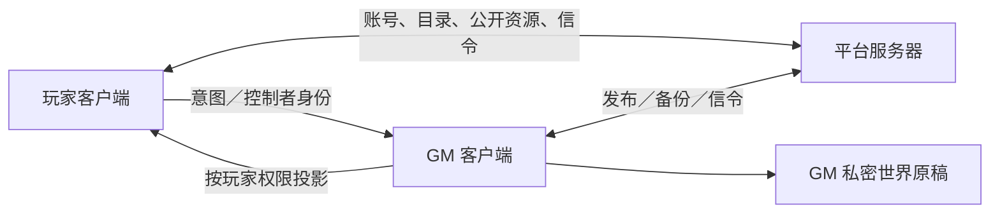

# 架构与扩展入口

## 责任划分

这里的“权威端”指 GM 客户端的事务与结算层，不等于公网 Node 服务。玩家只发送意图，GM 检查控制权、版本、行动费用和目标，保存成功后发布结果。平台服务不会加载每条规则的引擎，也不会运行场景画面。

| 源码包 | 职责 | 典型入口 |
| --- | --- | --- |
| `packages/contracts` | 可序列化模型、解析器、权限与注册项 | [合同字段](../../reference/packages/contracts/src/index.md) |
| `packages/rules-engine` | 纯规则计算与角色构建 | [规则引擎](../../reference/packages/rules-engine/src/index.md) |
| `packages/game-core` | 随机状态、战斗队列、地图与效果 | [核心](../../reference/packages/game-core/src/index.md) |
| `packages/session` | 世界事务、权限、投影、持久化与恢复 | [WorldDocument](../../reference/packages/session/src/world-types.md) |
| `packages/network` | 信令适配、WebRTC、分帧和重连 | [调用签名](../../reference/packages/network/src/index.md) |
| `packages/assets` | 哈希、JSON 资源、二进制缓存 | [素材接口](../../reference/packages/assets/src/index.md) |
| `packages/world-model` | 世界设定结构 | [总索引](../../reference/README.md) |
| `apps/desktop` | React、二维场景、Three.js、Tauri、本地 UI | [TableAction](../../reference/apps/desktop/src/tabletop/model.md) |
| `apps/server` | Express REST、`ws` 信令、文件持久化 | [HTTP](../api/http.md) |

当前服务端不是 Prisma 数据库／Socket.IO 架构。世界编辑也不是全规则共用一种 JSON：AAF 用 `WorldDocument`；DND、LANCER、心海及变体用 `ManualTable`，再装配各自战斗状态。

## 扩展一个数据能力

先判断现有 `ResourceActivity` 或规则专属 `automation` 是否能表达。可以表达时创建资源数据、依赖和示例，不改引擎。不能表达时添加合同、解析器、执行分支、投影、UI 入口和保存／恢复路径；仅添加 TypeScript 字段不算已接入。

变更应沿既有注册表进入；不要把所有分支放进 `App.tsx` 或世界屏幕。自然语言显示层不决定数值，主题外观不改变世界规则身份。必要验证包括合法输入、非法输入原子拒绝、未授权玩家看不到隐藏内容，以及保存后恢复。

## 权限与事务

`DocumentAccess` 有 `none / limited / observer / owner`，并有默认权限与逐用户覆盖。角色控制权与文档可读权限分别检查；共享名称并不等于授予编辑或操控。玩家收到的是投影，不能把投影当 GM 原稿保存回去。

AAF `WorldCommand` 包含 `requestId / expectedRevision / action`；请求指纹及回执参与幂等。ManualTable 的动作和文档子结构也各自携带修订号或旧值。冲突时重新读取，再由使用者确认合并；不要盲目修改期望修订号重放非幂等操作。

## 私有内容与源码快照

源码目录中有内置规则、生成目录和作者资料。公共文档只提取模型和接口，不把生成规则全文复制出去。`reference/source-snapshot.json` 的哈希用于确认文档与当前代码对应，不能用来恢复原文件。生产构建必须另记录实际源码提交或发布快照与依赖锁文件散列。
